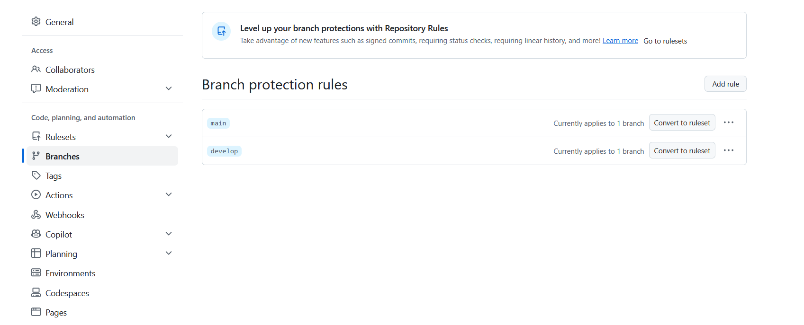

# Mada Settlement Lab

Plateforme sécurisée de contrôle qualité, de traçabilité et d'audit des données financières.

Application Web permettant de recevoir des déclarations financières **fictives**, de vérifier leur
conformité, de détecter les incohérences et d'assurer leur traçabilité.

**Stack** : React, Tailwind CSS (à venir), Python, FastAPI, PostgreSQL, MinIO, Docker.

Plateforme academique de collecte, validation, consolidation et audit de
declarations financieres **synthetiques**.

> ⚠️ **Disclaimer** — Projet academique independant. Toutes les organisations,
> transactions et donnees sont fictives. Ce projet ne represente ni l'architecture,
> ni les procedures, ni les systemes internes d'une institution financiere reelle.

## Statut
🚧 En construction — Sprint 0 (cadrage et squelette).

## Stack prevue
- Backend : FastAPI + PostgreSQL + MinIO
- Frontend : Next.js
- Observabilite : Prometheus + Grafana
- CI/CD : GitHub Actions (Gitleaks, Semgrep, Trivy)

