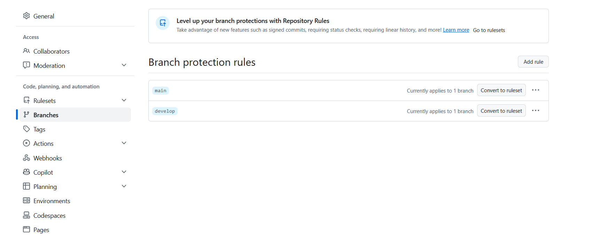

# Mada Settlement Lab

Plateforme academique de collecte, validation, consolidation et audit de
declarations financieres **synthetiques**.

> ⚠️ **Disclaimer** — Projet academique independant. Toutes les organisations,
> transactions et donnees sont fictives. Ce projet ne represente ni l'architecture,
> ni les procedures, ni les systemes internes d'une institution financiere reelle.

## Statut
🚧 En construction — Sprint 0 (cadrage et squelette).

## Stack prevue
- Backend : FastAPI + PostgreSQL + MinIO
- Frontend : Next.js
- Observabilite : Prometheus + Grafana
- CI/CD : GitHub Actions (Gitleaks, Semgrep, Trivy)

